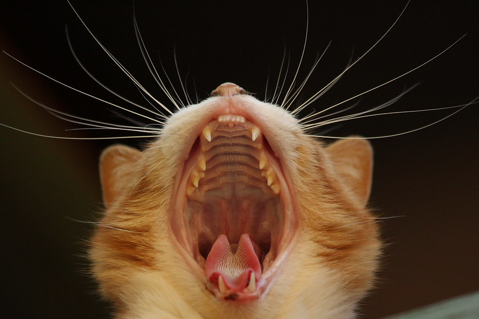

<table>
  <tr>
    <th colspan="4">Cat</th>
  </tr>
  <tr>
    <th style="background-color:#E3963E;">Orange</th>
    <th style="background-color:#FFB6C1;">Pink</th>
    <th style="background-color:#FFFFFF;">White</th>
    <th style="background-color:#556B2F;">Olive Green</th>
  </tr>
  <!--Hex-->
  <tr>
    <td>#E3963E</td>
    <td>#FFB6C1</td>
    <td>#FFFFFF</td>
    <td>#556B2F</td>
  </tr>
  <!--RGB-->
  <tr>
    <td>(227, 150, 62)</td>
    <td>(255, 182, 193)</td>
    <td>(255, 255, 255)</td>
    <td>(85, 107, 47)</td>
  </tr>
  <!--HSL-->
  <tr>
    <td>(32, 75%, 57%)</td>
    <td>(351, 100%, 86%)</td>
    <td>(0, 0%, 100%)</td>
    <td>(82, 39%, 30%)</td>
  </tr>
</table>
